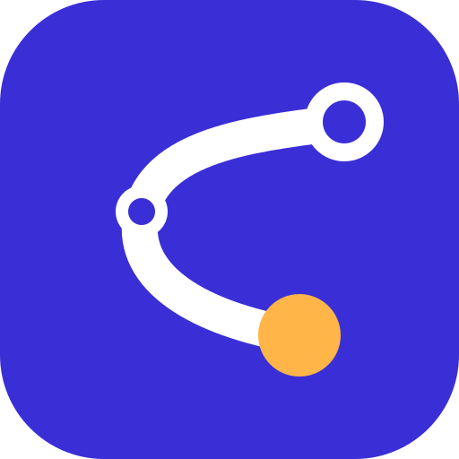

<p align="center"></p>

# Zug-Bot

Plant anhand des Stundenplans die Fahrt Gelnhausen ↔ TU Darmstadt, überwacht sie live,
plant bei Problemen neu und meldet sich per ntfy. Dazu ein Dashboard fürs Handy.
Läuft auf dem Raspberry Pi Zero W (`tradingbot.tailed8a6b.ts.net`).

## Aufbau

```
iPhone: ntfy-App + Browser (ohne Tailscale)
          ▲                     ▲
       ntfy.sh          https://tradingbot.tailed8a6b.ts.net/<schlüssel>/  (Tailscale Funnel)
          │                     │
┌─────── Raspberry Pi (zugbot.service) ──────────────────────┐
│ dienst.py   Takt alle 30 s: planen, überwachen, pushen      │
│ planer.py   Suche (mehrere Anfragen) ─┐                     │
│ bewertung.py Regeln + Punkte          │                     │
│ ueberwachung.py Live-Stand, Meldungen │                     │
│ web.py      Dashboard + /api/status   │                     │
│ wuensche.py eigene Zeiten, gewählte Option                  │
└───────────────────────────────────────┼─────────────────────┘
                                        ▼
         Transitous (Verbindungen, Tram/Bus)   DB Timetables API (Zug-Echtzeit, Gleise)
```

**Warum Transitous und nicht db-rest?** db-rest lief zwar auf dem Pi, aber die DB blockt
alle Anfragen von db-vendo-client (`OPS_BLOCKED`), und dessen Doku verlangt eine Erlaubnis
der DB. Transitous ist ein offener Dienst auf Basis der DELFI-Fahrplandaten; damit sucht
der Bot Verbindungen, und für Tram/Bus kommt von dort auch die Echtzeit.

**Echtzeit für Züge kommt von der DB** (Timetables-API, sobald ein Schlüssel in der `.env`
steht): Verspätung, Ausfall, Gleis. Ein Vergleich am 5.11.2026 an unseren 4 Bahnhöfen
ergab bei Transitous für 41 von 110 Zügen gar keine Echtzeit und 5 zu kleine
Verspätungen; die DB hatte alle. Ohne Änderung bei der DB gilt ein Zug ab 90 min vor
Abfahrt als pünktlich, vorher steht „Fahrplan“.

| Datei | Aufgabe |
|---|---|
| `config/stundenplan.yaml` | Termine, Semester, freie Tage (privat, nicht im Repo) |
| `config/einstellungen.yaml` | Haltestellen, Regeln, Puffer, Intervalle, Push-Zeiten |
| `.env` (nur auf dem Pi) | ntfy-Topic, Dashboard-Adresse, DB-Schlüssel |
| `zugbot/bewertung.py` | **Die Entscheidungslogik**, ausführlich kommentiert |
| `zugbot/planer.py` | Welche Anfragen gestellt und wie Stücke zusammengesetzt werden |
| `zugbot/ueberwachung.py` | Was als relevante Änderung gilt |
| `zugbot/gleise.py` | Gleise aus der DB-API |
| `zugbot/takt.py` | Welche Trams/Busse Hbf ↔ Campus passen, und in welchem Takt |
| `zugbot/wuensche.py` | Eigene Zeiten pro Tag, gewählte Option |
| `zugbot/ics_import.py` | TUCaN-Import |
| `daten/zustand.json` | aktueller Plan, Optionen, gesendete Meldungen (zum Reinschauen) |
| `daten/wuensche.json` | deine eigenen Zeiten und gewählten Verbindungen |
| `deploy/` | systemd-Unit, logrotate, Installations- und Deploy-Skript |

## Was wann passiert

| Wann | Was |
|---|---|
| 21:30 | Plan für morgen neu berechnen, Push („Morgen Do: Lichtwiese …“ oder „Morgen frei“) |
| bis 60 min vor Abfahrt | alle 30 min Live-Stand abfragen (frühestens 6 h vorher) |
| 60 min vor Abfahrt in Gelnhausen | Morgen-Push mit aktuellem Stand |
| ab 60 min vor Abfahrt bis Ankunft | alle 5 min abfragen |
| Ausfall, Anschluss weg, Umstieg zu knapp | neu planen ab deinem Punkt der Reise, Push mit hoher Priorität |
| Gleiswechsel, deutlich spätere Abfahrt | Push mit normaler Priorität |
| kleine Verspätung ohne Folgen | nichts (steht nur im Dashboard) |
| Bahndaten 3x nicht erreichbar | **eine** Meldung, eine weitere, wenn es wieder geht |
| Eigene Zeiten geändert | Tag sofort neu planen; Push nur für heute oder wenn der Abendplan schon raus ist |
| Andere Option gewählt | ab sofort diese überwachen (Morgen-Push, Meldungen, `/api/wecker`) |
| „Nehme ich“ auf der Abfahrtstafel | Rest der Fahrt ab diesem Zug planen, ab dann überwachen, Push mit neuem Plan |
| bei jeder Prüfung einer Fahrt | alle Optionen mit DB-Echtzeit auffrischen, Abfahrtstafel ab 90 min vorher |
| alle 30 min | Selbsttest: DNS, Transitous, DB, ntfy erreichbar? Fehler stehen oben im Dashboard |

## Regeln (Kurzfassung)

- Nur Nahverkehr (Deutschlandticket). ICE/IC/EC/Fernbus werden schon bei der Suche ausgeschlossen
  und zur Sicherheit nochmal geprüft.
- Immer über Frankfurt Hbf oder Frankfurt Süd. Nie Babenhausen oder Groß-Umstadt auf den
  **gefahrenen** Abschnitten (die RB zur Lichtwiese fährt danach dorthin weiter, das ist egal).
- Umstieg mind. 5 min, in Darmstadt Hbf mind. 7 min.
- Hinweg: späteste Abfahrt, die mit Puffer (5 min) vor dem ersten Termin ankommt.
  Weniger Umstiege und mehr Reserve geben Pluspunkte (`bewertung.py`, `punkte_hin`).
- Stadtmitte: Zug und Tram/Bus werden getrennt gesucht und in Darmstadt Hbf zusammengesetzt.
  Tram/Bus muss direkt an Schloss bzw. Willy-Brandt-Platz ankommen/abfahren.
- Rückweg: früheste Ankunft in Gelnhausen nach Ende des letzten Termins (+5 min).
- Optionen: Neben der besten Verbindung bleiben bis zu 6 weitere zur Auswahl, höchstens
  90 min früher/später und höchstens 40 min länger (`optionen` in den Einstellungen).
  Pro Zugkombination nur eine; welche Tram/welcher Bus noch passt, zeigt die Takt-Anzeige.

## Eigene Zeiten für einen Tag

Wenn du z. B. morgen erst um 10:00 an der Lichtwiese sein willst: im Dashboard unten
„Zeiten anpassen“ aufklappen, Tag wählen, Zeiten eintragen, Speichern. Oder im Terminal:

```bash
zugbot anpassen --datum morgen --an 10:00                 # da sein um 10:00
zugbot anpassen --datum 2026-11-12 --rueck 16:00 --campus stadtmitte
zugbot anpassen --datum morgen --zuruecksetzen           # wieder nach Stundenplan
zugbot anpassen                                          # alle eigenen Zeiten anzeigen
```

- **Da sein um** zählt wie ein Vorlesungsbeginn: Mit den üblichen 5 min Puffer bist du
  bei 10:00 um 9:55 am Halt.
- **Zurück ab** ist die früheste Abfahrt am Campus-Halt (ohne Zuschlag).
- **Spätestens zu Hause um** sucht die späteste Rückfahrt, mit der du bis dahin in Gelnhausen bist, auch wenn du dafür vor Vorlesungsende gehen musst (`zugbot anpassen --datum heute --heim 17:35`).
- **Campus** überschreibt den Campus aus dem Raum.
- An einem freien Tag braucht es alle drei Angaben, dann plant der Bot trotzdem.
- Geht für heute bis in 14 Tagen. Der Dienst übernimmt die Änderung innerhalb von Sekunden
  (heute/morgen); spätere Tage plant er wie immer am Vortag.

## Einstellungen ändern

Alles in `config/einstellungen.yaml`, z. B. Ankunftspuffer, Umstiegszeiten, Intervalle,
Uhrzeit des Abendplans, Gewichte der Bewertung. Danach:

```bash
./deploy/deploy.sh
```

(vom Mac aus im Projektordner; kopiert auf den Pi und startet den Dienst neu)

Direkt auf dem Pi geht auch: Datei in `~/zugbot/config/` bearbeiten, dann
`sudo systemctl restart zugbot`. Beim nächsten Deploy vom Mac wird sie aber überschrieben,
also Änderungen besser am Mac machen und committen.

## Stundenplan

`config/stundenplan.yaml` ist von Hand lesbar und änderbar (Felder stehen oben in der Datei).
Die Datei ist **privat**: Sie steht in `.gitignore` und landet nie auf GitHub.
`deploy.sh` kopiert sie trotzdem auf den Pi. Im Repo liegt nur
`config/stundenplan.beispiel.yaml` mit erfundenen Terminen; fehlt der echte Plan,
nimmt der Bot das Beispiel. Neu anlegen: `cp config/stundenplan.beispiel.yaml config/stundenplan.yaml`.

### Neuen Stundenplan aus TUCaN importieren

1. In TUCaN: Stundenplan → Export → iCalendar (.ics) herunterladen.
2. Anschauen, was erkannt wird (ändert nichts):
   ```bash
   .venv/bin/zugbot import-ics ~/Downloads/export.ics
   ```
3. Übernehmen (alte Datei wird als `stundenplan.yaml.bak` gesichert, Semesterdaten und
   freie Tage bleiben):
   ```bash
   .venv/bin/zugbot import-ics ~/Downloads/export.ics --schreiben
   ```
4. In `config/stundenplan.yaml` alles, was du nicht besuchst, auf `aktiv: false` setzen.
   Termine mit „BITTE PRÜFEN“ haben keinen erkennbaren Raum, dort den Campus kontrollieren.
5. Testen und auf den Pi bringen:
   ```bash
   .venv/bin/zugbot plan --datum 2027-04-19 --tage 5
   ./deploy/deploy.sh
   ```

Semesterzeitraum und freie Tage (`vorlesungsfrei`) für ein neues Semester von Hand
eintragen (Quelle: tu-darmstadt.de → Semestertermine).

## Testen ohne Benachrichtigungen

```bash
zugbot plan --datum 2026-11-09 --tage 5            # auf dem Pi
.venv/bin/zugbot plan --datum 2026-11-09 --details # am Mac, mit verworfenen Verbindungen
.venv/bin/pytest                                   # Regeltests
```

## ntfy auf dem iPhone einrichten

1. App „ntfy“ aus dem App Store installieren.
2. Topic auf dem Pi nachsehen: `ssh bene635@tradingbot.tailed8a6b.ts.net grep NTFY_TOPIC zugbot/.env`
3. In der App: **+** → „Subscribe to topic“ → Topic-Namen (ohne `NTFY_TOPIC=`) eintragen,
   Server `ntfy.sh` lassen → Subscribe.
4. Mitteilungen für ntfy in den iOS-Einstellungen erlauben. Damit dringende Meldungen
   (Verbindung klappt nicht mehr) auch im Fokus-Modus durchkommen: Einstellungen → Fokus →
   jeweiligen Fokus → Apps → ntfy hinzufügen.
5. Test: `ssh bene635@tradingbot.tailed8a6b.ts.net zugbot test-push`

Der Topic-Name ist das einzige Geheimnis: Wer ihn kennt, kann mitlesen. Neu würfeln:
neuen Wert in `~/zugbot/.env` eintragen, `sudo systemctl restart zugbot`, in der App neu abonnieren.

## Echtzeit und Gleise über die DB-API

1. Auf https://developers.deutschebahn.com registrieren, eine Anwendung anlegen und die API
   „Timetables“ abonnieren (kostenloser Plan).
2. Client-ID und API-Key auf dem Pi in `~/zugbot/.env` eintragen (`DB_CLIENT_ID`, `DB_API_KEY`).
3. EVA-Nummern der Bahnhöfe eintragen lassen: `zugbot haltestellen --eva`
   (schreibt in `config/einstellungen.yaml` auf dem Pi; danach die Datei auch am Mac übernehmen).
4. `sudo systemctl restart zugbot`

## Dashboard

Öffentlich per HTTPS über **Tailscale Funnel**, also auch auf dem Handy ohne Tailscale-App.
Adresse anzeigen (auf dem Pi):

```bash
zugbot dashboard-url
```

Die Adresse am iPhone in Safari öffnen → Teilen → „Zum Home-Bildschirm“. Die Seite
aktualisiert sich jede Minute selbst.

**Aufbau:** Oben die nächste Fahrt mit Countdown und Gleis, darunter die Reiter
„Heute“ und „Morgen“ (am breiten Bildschirm nebeneinander). Pro Tag Termin, eigene Zeiten
und je eine Karte für Hin- und Rückfahrt mit Zeitstrahl: Halte, Gleise, Umstiegszeiten,
Züge blau, Tram/Bus orange.

**Optionen:** Gibt es mehrere passende Verbindungen, stehen sie als Zeit-Chips über der
Karte, jeweils mit Live-Status („+12 min“, „fällt aus“, „Anschluss weg“). Antippen zeigt
sie an, Wischen über die Verbindung blättert genau eine weiter (am Mac: Pfeiltasten auf
den Chips). Der grüne Punkt markiert die überwachte Fahrt. „Diese nehmen“ macht die
angezeigte Option zur überwachten. Alle Züge haben DB-Echtzeit; kommt ein anderer
(z. B. verspäteter) Zug rechtzeitig am selben Umstiegsbahnhof an, erscheint er als eigene
Option „… bis Frankfurt Hbf, dann weiter wie geplant“.

**Blauer Kasten:** Zählt die Minuten bis zur Abfahrt selbst herunter. Unterwegs zeigt er nur den nächsten Schritt (Umstieg wo, welcher Zug, welches Gleis).

**Meldungen heute:** Die Pushes des Tages zum Nachlesen (`daten/meldungen.json`).

**Andere Züge anzeigen:** Lädt die Abfahrtstafel sofort, auch Stunden vor der Fahrt (nur heute).

**Abfahrtstafel:** Ab 90 min vor deinem nächsten Zug steht unter der Fahrt die Tafel
dieses Bahnhofs, nur Nahverkehr in deine Richtung, mit Echtzeit. Steigst du in einen
anderen Zug, tippe „Nehme ich“: Der Bot plant den Rest der Fahrt ab diesem Zug, überwacht
ab dann ihn und schickt den neuen Plan per Push. An einem Umstiegsbahnhof zählt die Tafel
erst ab deiner Ankunft dort.

**Schnell laden:** Ausführlich geladen wird nur die Hauptfahrt (Hinfahrt, bis du
angekommen bist, danach die Rückfahrt). Die andere ist eine Zeile und lädt erst mit
„Details“. Alles Rechnen mit Bahndaten macht der Dienst im Hintergrund; das Dashboard
liest nur. Seite, Logo und Schrift bleiben im Browser zwischengespeichert (Seite 10 min,
nach einem Deploy also spätestens dann aktuell).

**Tram und Bus:** Unter jeder Verbindung über Darmstadt Hbf stehen die direkten Trams
und Busse zwischen Hbf und Campus, die noch passen (Hinweg: nach Zugankunft + 7 min und
rechtzeitig am Campus; Rückweg: rechtzeitig für den Zug), mit Takt, z. B.
„Tram 2 etwa alle 5–10 min“. Deine eigene Fahrt ist hervorgehoben. Die Box steht im Zeitstrahl am Umstieg in
Darmstadt Hbf (Hinweg) bzw. am Campus-Halt (Rückweg). Fährt der Zug direkt
zur Lichtwiese (RB 82), entfällt die Anzeige. Dafür fragt der Bot pro Planung 2–4 Mal mehr
bei Transitous an.

**Schutz:** Die Seite liegt unter `/<DASHBOARD_SCHLUESSEL>/` (zufällig, aus der `.env`),
alle anderen Pfade liefern 404. Wer die vollständige Adresse kennt, sieht deinen Fahrplan
und kann Optionen wählen und Zeiten ändern, also nicht weitergeben. Geschrieben werden nur
JSON-Anfragen an `api/waehlen` und `api/anpassen`, mit geprüften Werten. Die Seite schickt keinen Referer an andere Seiten und ist für
Suchmaschinen gesperrt. Das Dashboard selbst lauscht nur auf `127.0.0.1:8080`; von außen
kommt man nur über Funnel hinein.

### Weckzeit: `/api/wecker`

`https://tradingbot.tailed8a6b.ts.net/<schlüssel>/api/wecker` liefert die Weckzeit für
**morgen**: Abfahrt in Gelnhausen minus `wecker.vorlauf_minuten` (Standard 40, in
`einstellungen.yaml`). Grundlage ist der gespeicherte Plan, der um 21:30 frisch berechnet
wird; der Endpunkt selbst fragt keine Bahndaten ab. Ist die Abfahrt schon als verspätet
bekannt, rechnet er mit der neuen Zeit.

```json
{"datum": "2026-11-05", "wochentag": "Donnerstag", "vorlauf_minuten": 40, "status": "ok",
 "frei": false, "weckzeit": "05:57", "weckzeit_iso": "2026-11-05T05:57:00+01:00",
 "abfahrt": "06:37", "linie": "RE 50", "gleis": "2", "campus": "Lichtwiese",
 "erster_termin": {"beginn": "08:00", "titel": "GdD Hörsaalübung", "raum": "L4|02 202"}, ...}
```

| `status` | Bedeutung | `weckzeit` |
|---|---|---|
| `ok` | Unitag, Verbindung geplant | gesetzt |
| `frei` | kein Unitag (`grund` sagt warum) | `null` |
| `keine_verbindung` | Unitag, aber keine passende Hinfahrt (`hinweis`) | `null` |
| `noch_kein_plan` | Dienst hat morgen noch nicht geplant (kurz nach dem Start) | `null` |

Gedacht z. B. für einen iPhone-Kurzbefehl, der abends nach 21:30 die Adresse abruft,
`weckzeit` ausliest und damit den Wecker stellt (oder bei `frei` keinen).

Neuen Schlüssel würfeln (alte Adresse wird ungültig):

```bash
sed -i '/^DASHBOARD_SCHLUESSEL=/d' ~/zugbot/.env && bash ~/zugbot/deploy/install.sh && zugbot dashboard-url
```

Funnel einrichten (einmalig, schon erledigt):

```bash
sudo tailscale funnel --bg 8080   # beim ersten Mal kommt ein Link zur Freigabe im Tailscale-Admin
tailscale funnel status           # zeigt, was öffentlich ist
sudo tailscale funnel --https=443 off   # Funnel wieder aus
```

## Betrieb und Fehlersuche

```bash
systemctl status zugbot                 # läuft der Dienst?
journalctl -u zugbot -n 100 --no-pager  # letzte Logzeilen
tail -f /var/log/zugbot/zugbot.log      # Log-Datei (wöchentlich rotiert, 4 Wochen)
zugbot status                           # gespeicherte Pläne, letzter Fehler
zugbot neu-planen --datum 2026-11-05    # Plan eines Tages verwerfen, wird neu berechnet
sudo systemctl restart zugbot
```

Typische Probleme:

| Symptom | Ursache / Lösung |
|---|---|
| „Bahndaten nicht erreichbar“ | Transitous gestört oder Pi offline. `curl -sI https://api.transitous.org/api/v1/health` |
| „Name nicht auflösbar (DNS)“ oben im Dashboard | DNS auf dem Pi kaputt. Am 5.11.2026 war das Tailscale-DNS ohne Upstream; behoben mit `sudo tailscale set --accept-dns=false` (Pi nutzt den Router). Prüfen: `getent hosts api.transitous.org` |
| Kein Push | Topic in App und `.env` vergleichen, `zugbot test-push` |
| Gleise fehlen bei Zügen | DB-Schlüssel fehlt oder EVA-Nummern leer (`zugbot haltestellen --eva`) |
| „Keine passende Hinfahrt“ | `zugbot plan --datum … --details` zeigt, warum jede Verbindung verworfen wurde |
| Falsche Zeiten nach Zeitumstellung | sollte nicht passieren (alles in Europe/Berlin); `timedatectl` prüfen |

## Datenquellen und Nutzungsregeln

- Fahrplan und Echtzeit: [Transitous](https://transitous.org) ([Quellen](https://transitous.org/sources/)),
  Kartendaten © OpenStreetMap-Mitwirkende. Regeln: https://transitous.org/api/ (User-Agent
  mit Kontakt, sparsame Abfragen, quelloffener, nicht kommerzieller Einsatz).
  Der Bot stellt etwa 10–25 Suchanfragen am Tag, Aktualisierungen laufen über `refresh-itinerary`.
- Zug-Echtzeit und Gleise: DB Timetables API (DB InfraGO), mit eigenem Schlüssel.
- Schrift: Figtree, SIL Open Font License (`zugbot/static/OFL-Figtree.txt`).
